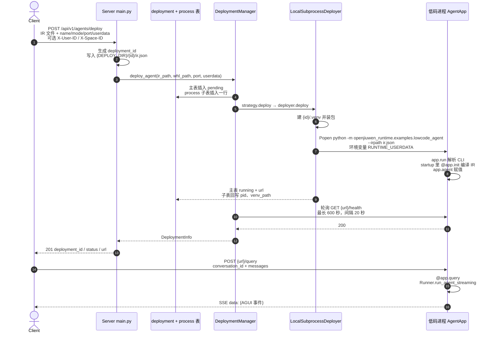

# Day 10：Applications 抽样 + 周复盘——低码进程里编译 IR，部署时序到 `/query`

Day 9 停在托管进程进的仍是 `app.run()`，`/query` 由 `@app.query` 写成 SSE。  
Day 10 只回答三件事：**低码这个进程里 init 实际做了什么、`applications/` 里另外三条服务各自解决什么、从 HTTP deploy 到 Agent `/query` 整条链怎么口述。**

精读：

- `applications/lowcode_agent/.../lowcode_agent_runner.py`（入口 `__main__.py` 只转调 `app.run()`）
- `applications/ir_execution_service/.../ir_execution_service_app.py`（路由与请求体）
- `applications/a2a_service/app.py`、`orchestrator/executor.py` 文件头
- `applications/versatile_adapter/app.py`、`dispatcher/runner.py` 文件头
- `docs/zh/5. 安全模块.md`

`agui_converter.py`、`stream_api.py` 的 chunk 映射、Executor 内部状态机今天不展开。安全模块只读到「为什么纯能力在 foundation」。

过关标志：能指出低码主路径是「一个部署一个进程、启动时编译一份 IR」；能用一句话说清另外三个应用不在这条链上；能不看文档画出从 `POST /api/v1/agents/deploy` 到 `POST {url}/query` 的时序；能指出多租户和 workspace 的边界仍是 Day 6 / Day 8 那两条。

---

## 今天在链路里的位置

```text
LocalSubprocessDeployer                         （Day 8）
  有 ir_path 时模块固定为
  python -m openjiuwen_runtime.examples.lowcode_agent
         --host 0.0.0.0 --port <port> --irpath <ir.json>
  环境变量 RUNTIME_USERDATA
        │
        ▼
 __main__.py → app.run()                       （Day 9：解析 CLI，uvicorn 拉起 AgentApp）
        │
        ├─ startup → @app.init                 读 IR、编译、app.agent = LLMAgent 或 WorkflowAgent
        ├─ GET  /health                         Manager 探活看到的就是这次 startup 已完成
        ├─ POST /query                          Runner.run_agent_streaming，yield AGUI 事件
        ├─ GET  /agent_detail                   把启动时缓存的整份 IR 原样返回
        └─ shutdown → @app.shutdown             只打日志
```

`ir_execution_service`、`a2a_service`、`versatile_adapter`、`foundation.security` 都不在这条箭头上。它们是同目录下的另外几条产品线，或给进程级组件用的密码学 SDK。

---

## 1. 低码主路径：`lowcode_agent_runner.py`

这个文件就是 Day 8 命令行拉起来的那个模块。类仍然是 Day 9 的 `AgentApp`，名字 `LowcodeAgent`。和 `simple_agent_app.py` 的差别在钩子函数体：init 不手写 Agent，而是把 Studio 导出的 JSON 编译成 `LLMAgent` 或 `WorkflowAgent`。

### 导入期就改环境

业务包导入之前，模块先改环境变量。顺序写在文件头注释里，不能后移。

| 步骤 | 做什么 |
| --- | --- |
| `RUNTIME_DB_TYPE` | 只接受 `mysql` / `sqlite` / `gaussdb` / `opengauss`，空或非法写成 `sqlite` |
| `RUNTIME_USERDATA` | 解析 JSON 里的 `env_vars`。系统里已经有的键不覆盖；`RUNTIME_DB_TYPE` 即使缺失也不从 userdata 写入 |
| 工作流超时 | `WORKFLOW_EXECUTE_TIMEOUT` 默认 `300`，并同步给首帧、帧间两个超时 |
| SSL | `RESTFUL_SSL_VERIFY`、`HTTP_SSL_VERIFY` 默认 `false`，对齐 Studio 插件调试 |
| 沙箱 | `CODE_SANDBOX_URL` 空则 `http://localhost:8188/run`，随后赋给 `remote_code_runner.code_sandbox_url` |

Runtime 用 gaussdb / opengauss 时，导入 `openjiuwen_studio` 之前会把进程里的 `RUNTIME_DB_TYPE` 改成 `LOWCODE_STUDIO_DB_TYPE`（默认 `sqlite`）。Studio 侧只认 `mysql` / `sqlite` / `none`。这是为了让低码进程能起来，不是把 Runtime 自己的库类型改掉。

日志打到 `{venv}/logs/agent_execution.log`。deployer 重定向的 `{deployment_id}/logs/agent.log` 只接 stdout / stderr。runner 还会摘掉一批 logger 上的 `StreamHandler`，所以 openjiuwen 的执行日志主要在 venv 里那份文件，不在 `agent.log`。

### `@app.init`：一份 IR，编译一次，挂到 `app.agent`

1. 读 `RUNTIME_IR_PATH`（Day 9：`--irpath` 写进这个环境变量），`json.load` 后放到 `app.ir_data`。
2. `RuntimeWorkflowRunner(export_config=整份 JSON)`。这里的 `current_user` 写死 `{"user_id": "test-user"}`，`space_id` 取 JSON 里 `agent.space_id`，没有则 `"default"`。管理面的 `X-User-ID` / `X-Space-ID` 不会进这个进程。
3. `AgentCompiler.compile_for_runtime`。`current_user` 同样是 `test-user`。
4. `_enrich_agent_workflows_with_dependency_inputs`：多工作流时 `agent.workflows` 往往只有 id / name / version，入参定义在 `dependencies.workflows`。这里把依赖里的 `input_parameters` 补回 agent 配置，否则任务入参会退化。
5. `ConfigAdapter.adapt` 之后按类型二选一：
   - `LegacyReActAgentConfig` → `LLMAgent`
   - `LegacyWorkflowAgentConfig` → `WorkflowAgent`
   - 其他类型直接 `TypeError`，进程起不来，deployer 的 `poll()` 或 Manager 的探活会失败。
6. 注册工作流：有 `workflow_providers` 就走它（保留 `input_params`）；否则退回 `workflow_factories`。插件走 `agent.add_tools`。
7. `app.agent = agent`。这一个实例服务之后所有 `/query`，和 Day 9 的实例模型一致。

`Runner.start()` 在编译之前调用。init 抛异常时 uvicorn 不会对外接受连接，Manager 在 600 秒内探不到 `/health`，部署记为 failed。

### `@app.query`：最后一条 user 消息，流式 AGUI

入参仍是 Day 9 的 `(msgs, request, cancel_event)`，产出仍是 `yield (event, last)`。框架负责写成 `data: {json}\n\n`，`last` 只告诉框架这一帧是不是这次响应的最后一帧。

处理顺序：

1. `conversation_id` 来自请求体。没有 user 消息时，yield 一组「请输入您的问题」的 AGUI 事件后返回。
2. 只取消息列表里**最后一条** `role=user` 的 `content`，收成 `inputs = {"query": 这段文本}`。更早的历史不由这个函数转发；多轮靠 `session=conversation_id` 交给 `Runner`。
3. `Runner.run_agent_streaming` 放在 `asyncio.to_thread` 里拿异步迭代器。总超时、首帧超时、帧间超时读三个环境变量，默认都是 init 时设的 300 秒。
4. 每个 chunk 经 `convert_chunk_to_agui_events` 变成事件再 yield，`last=False`。文本增量按 `AGUI_TEXT_DELTA_FLUSH_INTERVAL_SECONDS`（默认 0.12 秒）合并。
5. `cancel_event` 被置位就停循环。超时、执行异常、一个 chunk 都没有，各自 yield 一组 `agui_error_events` 并标最后一帧。注释写明：底层把错误吞掉时走不到 `except`，所以用 `chunk_count == 0` 兜这条。
6. 正常结束走 `finalize_agui_stream`，最后一帧 `last=True`。

`@app.agent_detail` 返回启动时缓存的整份 IR。缓存丢了就按 `RUNTIME_IR_PATH` 再读一次。

`@app.shutdown` 只打日志，不调用 `Runner.stop()`。对比：`ir_execution_service` 的 shutdown 会 `await Runner.stop()`。低码这条路径上，进程退出本身就是回收。

---

## 2. 另外三个应用各自解决什么

它们和「一个 `deployment_id` 拉起一个低码进程」不是同一条产品线。二次开发如果目标是托管自己的高码 Agent，本周主路径仍是 Day 8 + Day 9 + 上面这一节。

| 应用 | 解决的问题 | 和低码部署链的关系 |
| --- | --- | --- |
| `ir_execution_service` | 一个长期进程，按请求执行不同 IR | 不走 `AgentApp./query`，每次请求自带 `ir_path` |
| `a2a_service` | 用 A2A 协议做多 Agent / 工作流编排的用户入口 | 独立进程，任务状态在 Redis |
| `versatile_adapter` | 把 A2A 调用转成 Versatile 低代码平台的 HTTP+SSE | 只给 `a2a_service` 内部调用 |

### `ir_execution_service`：共享执行面，IR 在请求里

类是 `IrExecutionServiceApp(BaseApp)`，注释写明不继承 `AgentApp`。路由挂在 `BaseApp` 的 FastAPI 上：

| 方法 | 路径 | 响应 |
| --- | --- | --- |
| `POST` | `/execute_stream` | SSE |
| `POST` | `/execute_invoke` | JSON。HTTP 状态保持 200，业务成败看 body 里的 `code` |

请求体 `IrQueryBody`：`user_id`、`conversation_id`、`ir_path`、`inputs`、`timeout_ms`（默认 120000）。这里的 `ir_path` 是对象存储里的对象键，经进程内缓存和可选 Redis 读取，不落成本地文件。低码部署链上的 `ir_path` 是 `{DEPLOY_DIR}/{deployment_id}/ir.json` 这个本地路径。两个名字相同，含义不同。

启动钩子 `ensure_runtime_ready()` 然后 `Runner.start()`。一次请求里再 `build_react_agent_from_ir_dict` 或加载工作流依赖。会话上下文可进 `RedisContextPersistence`。这是「多份 IR 共用一个执行服务」，不是「一份 IR 独占一个 venv」。

### `a2a_service`：编排入口

进程自己建 FastAPI，不经过 `AgentApp`。文件头列出的端点：

| 方法 | 路径 | 谁用 |
| --- | --- | --- |
| `POST` | `/v1/{project_id}/agents/{agent_id}/conversations/{conv_id}` | 对齐 Versatile 的用户入口，可 SSE 或一次性 JSON |
| `GET` | `/a2a/.well-known/agent-card.json` | A2A Agent Card |
| `POST` | `/a2a/` | A2A JSON-RPC |

两条路径共用一个 `Executor` 和 `RedisTaskStore`。`Executor` 的职责写在文件头：首轮跑 `agent_stream()`；遇到委托就用 A2A Client 调 VersatileAdapter；任务状态 `WORKING` / `INPUT_REQUIRED` / `COMPLETED` 记在 Redis。它解决的是「一个对话里调度子 Agent 和工作流」，不是 Runtime 的部署记账。

### `versatile_adapter`：A2A 到 Versatile HTTP 的薄适配

`app.py` 写明：本服务只供 `a2a_service` 内部调用，不直接面向用户。端点是 A2A 标准的 `GET /.well-known/agent-card.json` 和 `POST /`（`message/send`、`message/stream`）。

`VersatileAdapterRunner` 按 YAML 路由：

- target 带 `workflow_id`，或 intent 命中某条 workflow 配置 → `VersatileWorkflow`
- 否则 → `VersatileController`

配置查找顺序：构造参数、环境变量 `VERSATILE_PROXY_CONFIG_PATH`、`/etc/edpagent/config/versatile_proxy.yaml`、包目录下的 `versatile_proxy.yaml`。真正打到 Versatile 平台的是 `VersatileProxy`：HTTP + SSE，URL、请求头、请求体由子类钩子填。Task 有 Redis 时进 `RedisTaskStore`，没配 Redis 时用内存。

一句话：`a2a_service` 决定调谁，`versatile_adapter` 负责把这次调用变成对 Versatile 平台的流式 HTTP。

---

## 3. `foundation.security` 为什么能被 WorkSwarm 单独依赖

`docs/zh/5. 安全模块.md` 把安全 SDK 拆成两层：

| 层 | 模块 | 有什么 | 依赖 |
| --- | --- | --- | --- |
| foundation | `openjiuwen_runtime.foundation.security` | 加解密、加签验签、link-auth（含进程内 TOFU） | 只有 `cryptography` |
| management | `openjiuwen_runtime.management.security` | 落库的 `CertificateManager`、`CertificatePinStore`，并 re-export foundation 的符号 | foundation + `DBHandler` |

纯能力放 foundation，是为了让**没有控制面**的进程（文档里的例子是独立 AgentServer）直接做握手鉴权和加解密。落库、轮换、解绑才需要 management。

WorkSwarm 是办公协作入口，学习计划里写的依赖边界就是「只依赖本仓 `foundation`」。它要的是进程级握手（`build_token_header`、`InMemoryPinStore`、`verify_and_pin`）和信封加密，不需要 DeploymentManager，也不需要 `security_local_key` / `security_peer_key` 那两张表。把原语留在 foundation，WorkSwarm 就不必把 `management` / `server` 整包引进去。历史导入 `from openjiuwen_runtime.management.security import ...` 仍然可用，那是 re-export，不是 WorkSwarm 该走的路径。

和本周部署链的关系：默认 `CLAW_LINK_AUTH_MODE=off`，deploy 和 `/query` 的行为不变。这条 SDK 解决的是 Manager、Gateway、AgentServer 之间控制链路的身份和配置下发，不是低码 IR 怎么编译。

四块能力记名字即可：

| 能力 | 默认实现 | 记这一句 |
| --- | --- | --- |
| 加解密 | AES-256-GCM + X25519 信封 | 大数据用一次性 DEK 对称加密，DEK 用对端公钥包起来 |
| 加签验签 | Ed25519 | 验签失败统一返回 False |
| 证书落库 | `CertificateManager` | 私钥只在本端 local 表，对端表只存公钥 |
| link-auth | Ed25519 一次性令牌 + nonce + 指纹固定 | `off` / `observe` / `enforce` 三档，默认 off |

---

## 4. 部署时序图：HTTP deploy → Agent `/query`

下面是默认 `subprocess`、低码（请求里带 IR 文件）的一条成功路径。高码差别只在 deployer：没有 `ir_path` 时 `-m` 用子表里的 `package_name`，不传 `--irpath`。Docker / K8s 的策略不同，时序在 `strategy.deploy` 之后换 deployer，今天不画。



口述可以压成八句：

1. 管理面收到上传的 JSON，用新的 `deployment_id` 存成 `{DEPLOY_DIR}/{id}/ir.json`，租户头只写进主表。
2. `deploy_agent` 把 `package_name` 设成请求里的 `name`，然后 `_deploy`：主表 `pending`，按 `mode` 写 process 子表。
3. 子表有 `ir_path` 时，真正拉起的模块固定是 `openjiuwen_runtime.examples.lowcode_agent`，并带 `--irpath`。库里的 `package_name` 仍是请求里的名字，不参与这条命令。
4. `MODE=dev` 时 venv 里装 `dist/` 下的基础 whl，再装 `whl_path` 指向的包。非 dev 时这条路径改为安装 PyPI 上的 `lowcode-agent-runner`。
5. 子进程就是 Day 9 的 `app.run()`。`startup` 跑完 `@app.init` 之后，uvicorn 才接受连接。
6. deployer 返回 `http://{IP}:{port}/` 后，基类把主表改成 `running` 并写入 url；子类再把 `pid`、`venv_path` 写回 process 表。
7. Manager 在进程已经标成 running 之后才探 `{url}/health`。探活成功，HTTP 才回 201。init 编译久，时间算在这 600 秒里。
8. 之后的对话不回管理面。客户端直接 `POST {url}/query`，低码钩子把最后一条用户话交给 `Runner.run_agent_streaming`，响应是 AGUI 事件的 SSE。

失败时：deployer 返回失败或探活超时，主表改成 `failed`，异常抛回路由，HTTP 500，detail 以 `Deployment failed` 开头。2 秒内进程就退出，会在 deployer 里先失败，走不到探活。

---

## 5. 周复盘：这条链上多租户和 workspace 的边界

第 2 周验收两条：能口述部署链路；能指出多租户和 workspace 的能力边界。链路是上一节。边界是 Day 6 和 Day 8 的结论，今天在低码进程里又对上一次。

| 能力 | 现在实际做什么 |
| --- | --- |
| 租户标签 | `X-User-ID` / `X-Space-ID` 写入主表。缺头时用默认租户，不 401 |
| 列表 | 带头时按 `user_id` + `space_id` 过滤；头空则能看到全部 |
| get / delete | 路由拿到租户上下文后没有拿去比对。知道 `deployment_id` 就能查、能删 |
| 对话进程 | 管理面的租户头不注入子进程。低码 init 里的 `current_user` 写死 `test-user` |
| 会话 | `/query` 的隔离键是 body 里的 `conversation_id`，框架不存历史 |
| workspace | 没有。磁盘上只有 `{DEPLOY_DIR}/{deployment_id}/`：`ir.json`、`.venv/`、`logs/` |

所以本仓是部署与进程托管底座。项目组隔离、归属校验、业务工作区都还要在治理层补，对应第 4 周，而不是再改这条拉起进程的链。

`applications/` 里另外三条服务也不补这个缺口：`ir_execution_service` 的 `user_id` 在执行请求体里，由调用方传入；`a2a_service` 的路径参数是 `project_id`，那是它自己的入口约定，不是 Runtime 主表的 `space_id`。

---

## 今天可以停在这里

- 低码主路径：一个部署、一个 venv、一个进程、启动时编译一份本地 `ir.json`，之后所有 `/query` 打在同一个 `app.agent` 上。
- `ir_execution_service` 是共享执行服务；`a2a_service` + `versatile_adapter` 是另一条 A2A 编排线；`foundation.security` 是给 WorkSwarm 这类进程用的密码学，默认不改变 deploy。
- 下周进高码：CLI 模板、自己写 `@app.init` / `@app.query`，再走同一条 Manager → venv → `app.run()`。差别是没有 `--irpath`，也没有今天这份编译器。
