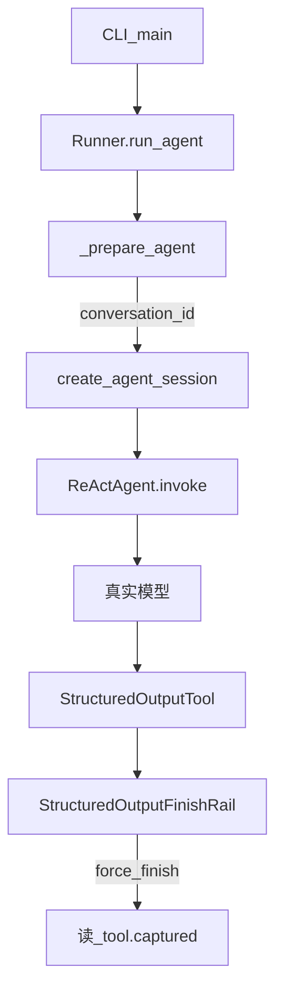

# ReActAgent 结构化输出：FinishRail 收口与 Runner 取 Session

对应 demo：`react_structured_session`。  
不改现有 demo。接真实模型。CLI 跑通三件事：`ReActAgent` 能调模型；挂上 `StructuredOutputTool` + `StructuredOutputFinishRail` 后权威结果读工具 `captured`，不解析正文；`Runner.run_agent` 凭 `conversation_id` 创建并复用 `AgentSession`。

类名以 openjiuwen / agent-core 为准：`ReActAgent`（不是 ReactAgent）。

## 功能介绍

- 创建 `ReActAgent`，经 `common.SharedModel` / 仓库根目录 `.env`（`API_BASE`、`API_KEY`、`MODEL_NAME`、`MODEL_PROVIDER`）配模型。system 提示强制：结束前必须调用一次 `structured_output`，不要用自由文本当最终答案。
- 注册 `StructuredOutputTool(schema)` 与 `await agent.register_rail(StructuredOutputFinishRail())`。模型成功调用工具后，rail 在 `after_tool_call` 里 `request_force_finish`，立刻结束本轮 ReAct；权威结果读该工具实例上的 `captured`。
- 用 `create_agent_session(session_id=conversation_id, card=agent.card)`（工厂 `create_session_for_agent`）建 session，再 `Runner.run_agent(..., session=session)`。同 `conversation_id` 跑两轮，CLI 打印两侧 `session_id`，验收一致。

## 使用场景

固定演示脚本（真实模型）：

1. Query：「把明天下午三点的团队周会记成待办，优先级高。」
2. Schema 写死为：

```json
{
  "type": "object",
  "properties": {
    "title": {"type": "string"},
    "due": {"type": "string"},
    "priority": {"type": "string", "enum": ["low", "medium", "high"]}
  },
  "required": ["title", "due", "priority"]
}
```

3. 期望：`captured` 非空，`priority` 为 `high`；CLI 打印 `conversation_id`、本轮 `session_id`、以及 `captured` JSON。
4. 同一 `conversation_id` 再发一轮（例如「把优先级改成 medium」或任意跟进句），再打印一次 `session_id`，与首轮相同。

## 不在本 demo

- 无前端、A2UI、SwarmFlow、ControllerAgent。
- 不测 HITL interrupt、不测 workflow session（`create_workflow_session`）。
- 不做 mock LLM；必须填好根目录 `.env`。

## 架构



目录：

```text
react_structured_session/
  backend/agent_factory.py   # ReActAgent + schema 工具 + FinishRail
  backend/main.py            # CLI：两轮同 conversation_id
  README.md
```

## 关键 API 与接线要点

落地时按下列顺序接线（对照 agent-core 的 HITL / tiny_agent 用法）：

1. **Agent**

```python
from openjiuwen.core.single_agent.agents.react_agent import ReActAgent, ReActAgentConfig
from openjiuwen.core.single_agent import AgentCard
```

`ReActAgent(card=AgentCard(...))`，`configure(ReActAgentConfig())`，模型走 `get_shared_model()` 与现有 demo 一致。

2. **结构化工具与 Rail**

```python
from openjiuwen.agent_teams.tools.structured_output_tool import (
    StructuredOutputTool,
    StructuredOutputFinishRail,
)
```

- 构造 `StructuredOutputTool(schema_json)`，schema 即工具的 `input_params`。
- `Runner.resource_mgr.add_tool(tool)`，再 `agent.ability_manager.add(tool.card)`。
- `await agent.register_rail(StructuredOutputFinishRail())`。

3. **Runner 取 Session**

本 demo 用 Agent 的 card 显式建 session，再交给 `run_agent`：

```python
from openjiuwen.core.single_agent import create_agent_session

session = create_agent_session(session_id=conversation_id, card=agent.card)
# 或 factory：create_session_for_agent(agent, conversation_id)

await Runner.start()
result = await Runner.run_agent(
    agent=agent,
    inputs={
        "query": query,
        "conversation_id": conversation_id,
    },
    session=session,
)
```

`Runner._prepare_agent`：显式传入 `AgentSession` 时直接 `pre_run` 复用；未传则用 `inputs["conversation_id"]`（缺省 `"default_session"`）走 `_create_agent_session`。

4. **读结果**

本轮结束后读同一 `StructuredOutputTool` 实例的 `captured` / `called`。正文与 `Runner` 返回值里的自由文本不作为权威结果。

5. **无参工具读 session（踩坑）**

**继承 `Tool`**：框架是 `await tool.invoke(tool_args, session=session)`，必须：

```python
async def invoke(self, inputs: dict, **kwargs):
    session = kwargs.get("session")
    data_context = session.get_state("data_context")
```

没有 `**kwargs` 会报 `unexpected keyword argument 'session'`。

**`@tool` 注解**：`LocalFunction` 只做 `_func(**inputs)`，**不会**把 kwargs 的 session 传进函数。正确写法是函数内 `get_current_session()`（`ReActAgent._inner_invoke` 有 `@with_session`，会把 session 放进 ContextVar）。**不要**把 `session` 写进函数签名（会进 JSON Schema，且不会被注入）。

```python
@tool
async def read_data_context_via_ctx() -> dict:
    session = get_current_session()
    return session.get_state("data_context")
```

注意：直接 `tool.invoke({})`（不在 Agent invoke 里）时 ContextVar 为空；只有走 `Runner.run_agent` / Agent 循环时才有值。

`update_state` 应在 `pre_run`（restore）之后写。demo 见 `backend/session_tools.py`。

## 原理短注

- **结构化输出走 tool-use**：harness 无原生 `response_format` 接线；用 `structured_output` 工具参数承载 schema，像 `return`/`submit`，不是「提示词要 JSON 再正则抠」。
- **FinishRail**：`priority=900`；仅当工具名为 `structured_output` 且调用**成功**（无 exception）时 `request_force_finish`。参数坏了不 force-finish，错误回给模型自纠。工具 ack 只是 `{"accepted": True}`，单靠它停不了循环，所以必须靠 rail。
- **Runner 与 session**：`conversation_id` 决定 session 身份；同 id 多轮应落到同一 session 路径。要自己管生命周期时可直接把 `AgentSession` 传给 `run_agent`。

## 运行

仓库根目录（`.env` 已填写 `API_BASE` / `API_KEY` / `MODEL_NAME` / `MODEL_PROVIDER`）：

```bash
source .venv/bin/activate
cd react_structured_session
python -m backend.main
```

## 验收

1. 首轮结束且 `tool.captured` 含 `title`、`due`、`priority`，且 `priority == "high"`。
2. 成功调用 `structured_output` 后本轮循环结束（FinishRail 生效），不依赖模型自己停。
3. 两轮使用相同 `conversation_id`，日志中两侧 `session_id` 一致。
4. 正文不当权威结果：即使模型多说了话，CLI 只展示并断言 `captured`。
