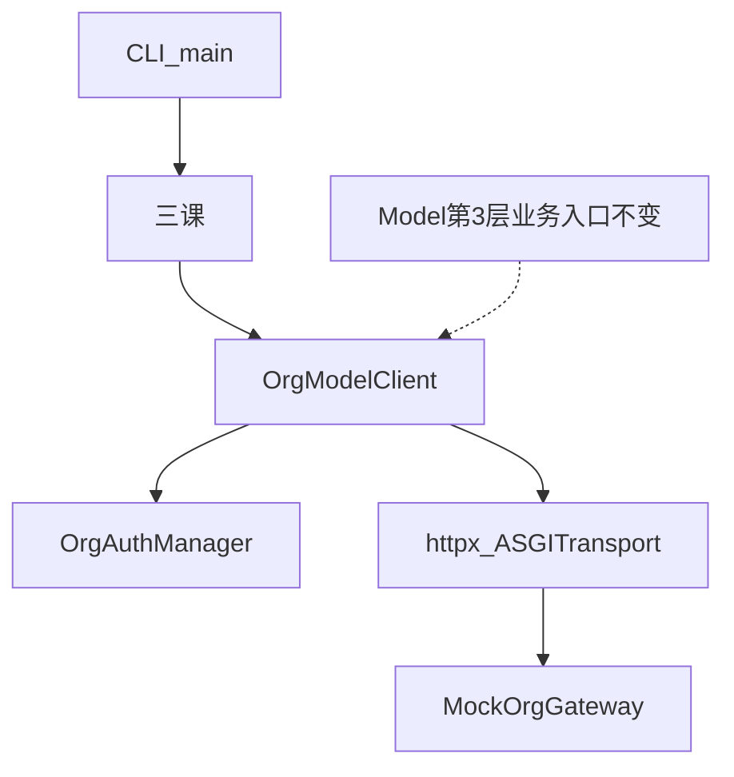

# 组织 LLM 接口 v2 与动态 token 接入

对应 demo：`org_llm_gateway`。  
原理文：`org_llm_gateway/doc/组织网关不是改api_base-用三课看v2路径非Bearer与动态token.md`。  
断点笔记：`doc/2026-11-02-组织LLM接口v2与动态token接入.md`。

对齐 openjiuwen 三级模型，用本地假网关跑通三课：路径、非 Bearer、动态 token。不接真实组织接口、不接真实模型。

## 功能介绍

- 讲清落层层：`Model`（业务入口）→ `ModelClient`（协议/鉴权/URL）→ `AsyncOpenAI` / httpx（真正发 HTTP）。
- **课 1 路径**：组织真实路径是 `{prefix}/chat/completions/v2`。演示 `_normalize_openai_base_url` / `_chat_completions_url` 只改 `api_base` 的三种错拼；`OrgModelClient` 用显式 `completions_path` 打中假网关。
- **课 2 鉴权**：不是 `Authorization: Bearer`。`auth_mode=CustomHeaders` + 空 `api_key` → `_should_omit_authorization`；假网关见到 Authorization 直接 400；Client 只带 `X-Org-Access-Token`（演示头名，真实对接时替换）。
- **课 3 动态 token**：`OrgAuthManager.resolve_token(force_refresh=...)` 负责缓存/过期/刷新；`OrgModelClient` 每次请求注入，401/403 有限次 `force_refresh` 再打；`Model` 不管 token。

## 使用场景

固定 CLI 脚本（假网关）：

1. `python -m backend.main path`：对照错误 URL 与正确 URL。
2. `python -m backend.main auth`：Bearer 被拒，自定义头通过。
3. `python -m backend.main token`：缓存命中、吊销后 401 重试成功。

## 不在本 demo

- 不改 agent-core 源码，不注册正式 provider 到社区包。
- 不接真实 IAM / 真实 LLM；流式 SSE、签名头、租户 ID 等待确认项只在文档列出。
- 无前端、无 Agent / Workflow。

## 架构



目录：

```text
org_llm_gateway/
  backend/mock_gateway.py      # 假网关：只认 /org/llm/chat/completions/v2
  backend/org_auth.py          # OrgAuthManager
  backend/org_model_client.py  # OrgModelClient
  backend/lessons.py           # 三课
  backend/main.py              # CLI
  doc/                         # 知乎文
  README.md
```

## 关键 API 与接线要点

1. **配置**
   - `api_base` = 到组织前缀为止，例如 `https://gw.example.com/org/llm`
   - `completions_path` = `chat/completions/v2`
   - `auth_mode=CustomHeaders`，`api_key=""`
   - 静态 `custom_headers` 只放不变的头（租户、来源等）

2. **AuthManager**
   - 只暴露 `resolve_token(force_refresh=False)`
   - 内部：skew、缓存、加锁；demo 用内存计数器模拟签发

3. **ModelClient**
   - 发请求前取 token，写入组织要求的 header 名
   - 401/403 → `force_refresh` 再打一次
   - 协议体仍是 OpenAI chat/completions JSON 时，解析可复用；本 demo 用 httpx 直 POST

4. **禁止**
   - 业务侧每次 `model.invoke(..., custom_headers={token})`
   - 把会过期的 token 写进静态 `custom_headers`
   - 改共享 `AsyncOpenAI` 全局 `api_key` 做刷新
   - 把刷新逻辑塞进 `Model`

## 相关源码索引（agent-core）

- URL：`openai_model_client._normalize_openai_base_url` / `_chat_completions_url`
- 鉴权：`schema/config.py` → `LLMAuthMode`；`_should_omit_authorization`
- 动态 token 先例：`openai_account_model_client.py`、`extensions/external_provider/openai_auth/openai_account_auth.py`
- 测试参考：`tests/unit_tests/core/foundation/llm/test_openai_affinity_gateway.py`

## 待确认（真实对接时）

1. 完整 URL 前缀与是否严格为 `{prefix}/chat/completions/v2`
2. 鉴权头具体名字、是否还要时间戳/签名/租户 ID、是否禁止出现任何 `Authorization`
3. 流式是否标准 SSE；错误体是否 OpenAI 风格
4. 业务侧配置形态：显式 OpenAI + auth_mode，还是包装成组织 provider 名
